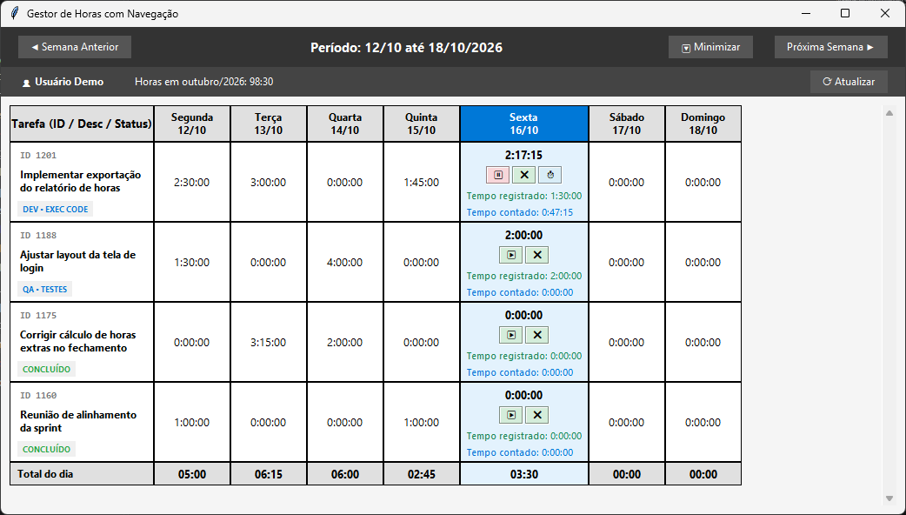

# RedPy — Gestor de Horas para Redmine

Aplicativo desktop para Windows que mostra, em um quadro semanal, as horas lançadas no Redmine por tarefa. Ele também cronometra o trabalho do dia e registra o tempo direto no Redmine.



<sub>Print com dados fictícios de demonstração.</sub>

## Funcionalidades

- **Quadro semanal** (segunda a domingo) com as horas lançadas por tarefa e por dia, e uma linha **Total do dia** no final. Use os botões *◀ Semana Anterior* e *Próxima Semana ▶* para navegar. A tabela tem barra de rolagem e aceita a roda do mouse.
- **Cabeçalho** com o nome do usuário do Redmine, o total de horas lançadas no mês atual e o botão **⟳ Atualizar**, que consulta o Redmine de novo ignorando o cache.
- **Sem conexão/VPN**: o quadro mostra os dados do cache e um aviso no cabeçalho.
- **Tarefa atribuída**: a tarefa atribuída a você com status `DEV • Exec...` aparece no quadro mesmo sem horas lançadas na semana.
- **Cronômetro por tarefa** na coluna do dia atual:
  - `▶` inicia a contagem. Se outra tarefa estiver rodando, ela é pausada antes.
  - `⏸` pausa e acumula o tempo.
  - `❌` zera o tempo contado localmente.
  - `⏱` abre o diálogo de registro: você revisa o tempo (HH:MM:SS), escolhe a atividade e escreve a descrição. O lançamento é criado no Redmine.
- **Pausa automática** quando a sessão do Windows é bloqueada. A tarefa volta a contar no desbloqueio.
- **Ícone na bandeja do sistema**: um clique abre a janela. O menu tem Mostrar, Ocultar e Sair. O botão *🔽 Minimizar* manda a janela para a bandeja.
- **Cache local** (`tasks.pkl`) das tarefas, das semanas consultadas e do cronômetro em andamento. A semana atual é consultada no Redmine sempre que o quadro é carregado. Semanas passadas são consultadas uma vez por execução do app; depois disso, só pelo botão Atualizar. O status das tarefas é atualizado junto com a semana.

## Requisitos

- Windows (usa `pywin32` para os eventos de sessão e para cifrar a chave)
- Python 3.13 (testado com 3.13.14)
- Acesso a uma instância do Redmine com a API REST habilitada e uma chave de API pessoal

Dependências:

| Pacote | Versão testada | Uso |
|---|---|---|
| `python-redmine` | 2.5.0 | Cliente da API do Redmine |
| `pystray` | 0.19.5 | Ícone na bandeja do sistema |
| `pillow` | 12.2.0 | Imagem do ícone |
| `pywin32` | 311 | Eventos de bloqueio de sessão e cifragem (DPAPI) |
| `pyinstaller` | — | Só para gerar o executável |

```bash
pip install python-redmine pystray pillow pywin32
```

## Como executar

```bash
python main.py
```

### Conexão com o Redmine (URL e chave de API)

A URL e a chave **não ficam no código**. No primeiro uso, o app abre uma janela pedindo as duas:

1. Informe a **URL do Redmine** (ex.: `https://redmine.suaempresa.com/`).
2. No Redmine, acesse **Minha conta → Chave de acesso à API**, copie a chave e cole no campo **Chave de API**.
3. Clique em **OK**. O app valida a chave nessa URL antes de aceitar.

A URL e a chave são gravadas em `config.pkl`. A chave vai cifrada com o **DPAPI do Windows**: só o mesmo usuário Windows, na mesma máquina, consegue decifrá-la.

| Situação | Comportamento |
|---|---|
| Primeira execução | Pede a URL e a chave |
| Configuração salva e válida | Abre direto |
| Chave salva recusada pelo Redmine (revogada/trocada) | Abre a janela com a URL preenchida e pede uma nova chave |
| Sem rede/VPN ao abrir | Usa a configuração salva sem validar |
| Cancelar a janela | Fecha o app sem gravar nada |

Para trocar a URL ou a chave manualmente, apague o `config.pkl` e abra o app de novo.

> Se você trocar de servidor Redmine, apague também o `tasks.pkl`: o cache de tarefas é de um servidor só.

## Gerar o executável

```bash
compile.bat
```

O script roda o PyInstaller (`--onefile --noconsole`, com o ícone `icon/relogio.ico` embutido) e gera `dist/main.exe`. O arquivo `main.spec` traz a mesma configuração.

> O `tasks.pkl` e o `config.pkl` são gravados na **pasta de onde o app é executado**. Ao rodar o `.exe` de outra pasta, a URL e a chave serão pedidas de novo e o cache começará vazio.

## Estrutura do projeto

| Arquivo | Responsabilidade |
|---|---|
| [main.py](main.py) | Ponto de entrada e interface Tkinter (`QuadroHorasNav`): quadro semanal, cronômetro, navegação |
| [RedManager.py](RedManager.py) | Integração com o Redmine (tarefas, lançamentos, atividades), retry HTTP e cache em `tasks.pkl` |
| [ApiKeyConfig.py](ApiKeyConfig.py) | Diálogo de URL e chave de API, validação e gravação em `config.pkl` (chave cifrada) |
| [RegisterTimeDialog.py](RegisterTimeDialog.py) | Diálogo de confirmação do registro de horas |
| [TrayIcon.py](TrayIcon.py) | Ícone e menu na bandeja do sistema |
| [WindowsPowerMonitor.py](WindowsPowerMonitor.py) | Janela oculta que recebe os eventos de bloqueio/desbloqueio da sessão do Windows |
| [compile.bat](compile.bat) / [main.spec](main.spec) | Build com PyInstaller |
| [icon/](icon/) | Ícones do app |
| [todo.md](todo.md) | Pendências e ideias |
| `Bkp/` | Cópia antiga do código (não usada pelo app) |

## Arquivos locais (não versionados)

O `.gitignore` exclui:

- `*.pkl`: `tasks.pkl` (cache) e `config.pkl` (URL e chave cifrada). **Nunca versione estes arquivos.**
- `build/`, `dist/`, `__pycache__/`

## Limitações conhecidas

- Só funciona no Windows.
- A pausa automática reage ao **bloqueio de sessão** (`WTS_SESSION_LOCK`), não à suspensão/hibernação em si.
- `testPowMon.py` está desatualizado em relação à API atual do `WindowsPowerMonitor` e não roda.
- Veja outras pendências em [todo.md](todo.md).

## Licença

GNU General Public License v3.0. Veja [LICENSE](LICENSE).
